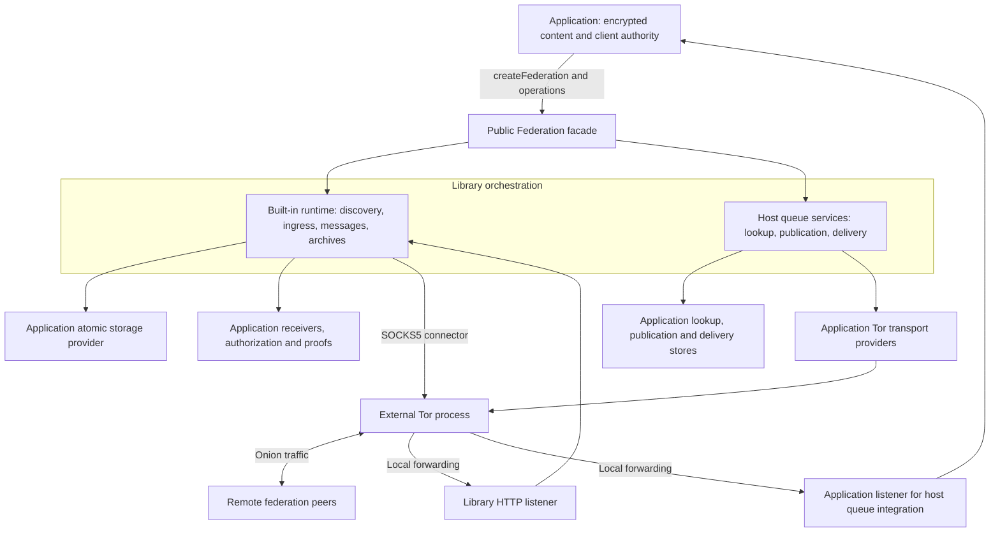
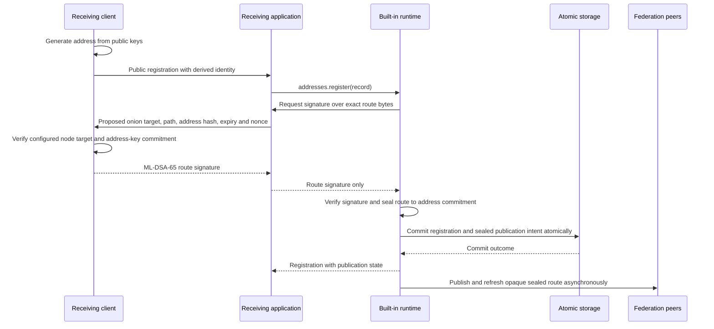
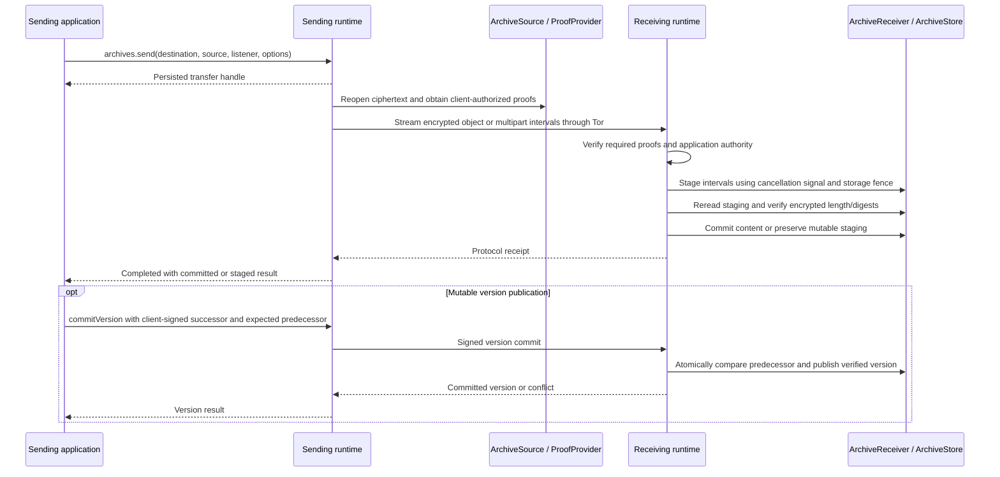

# Architecture

Federation Privacy Library connects independently operated applications through
address discovery and encrypted transfers over Tor. Applications construct one
`Federation` with `createFederation(configuration)`. The library owns protocol
validation, discovery, publication, delivery scheduling, and transfer lifecycle.
Applications supply persistence, encrypted content, access policy, and handlers.

The runtime is Node.js 22 or later, using ESM and Web
`ReadableStream<Uint8Array>` streams. The API is experimental. See the
[runtime contracts](runtime.md) for guarantees and supported limits.

## Components And Ownership



The two orchestration paths are enabled by the supplied capabilities; an
application need not configure both. A host queue integration serves inbound
requests through its own application listener. The built-in runtime owns its
HTTP listener and ingress processing.

| Library owns                                               | Application or operator owns                                       |
| ---------------------------------------------------------- | ------------------------------------------------------------------ |
| Address derivation and public-key commitment checks        | Client-held private keys and private address distribution          |
| DHT discovery, publication, routing and retries            | Storage adapters, backend transactions and replication             |
| Wire codecs, mandatory verification and transfer integrity | Content encryption, decryption and sender authentication           |
| Protocol transfer state, recovery and shutdown             | Durable source access, receiver effects and product workflows      |
| SOCKS connections and the built-in HTTP listener           | Tor installation, process lifecycle and onion-service provisioning |

Tor is a separate process. The library connects to its SOCKS proxy and listens
on a configured loopback port; Tor forwards an onion service to that listener.
The library does not install or launch Tor, create onion identities, or manage
Tor configuration. Application transport providers serve the host queue path;
they do not replace the built-in runtime's SOCKS connector.

## Public Entry Points

| Entry point  | Use                                                                                         |
| ------------ | ------------------------------------------------------------------------------------------- |
| Package root | `createFederation`, public interfaces, address utilities, errors and pure `protocol` codecs |
| `/adapters`  | Reference memory storage and storage implementation utilities                               |
| `/testing`   | Internal compatibility fixtures for library tests                                           |

Applications use the factory and public interfaces. Internal runtimes,
coordinators, resolvers and workers are assembled by the facade.

## Capability Matrix

**Built-in runtime:** supply `storage.addresses`, `storage.state`,
`storage.lease`, and `storage.commit` together, plus complete `tor` configuration.
These providers must implement the [atomic storage contract](runtime.md#construction-and-storage).

**Host queue integration:** supply lookup/publication/delivery capabilities and
bounded Tor transports. This path uses the host's queue and inbound listener.
It does not provide the built-in runtime's registrations or transfer handles.

| Operations                                                 | Required capabilities                                                               |
| ---------------------------------------------------------- | ----------------------------------------------------------------------------------- |
| `addresses.register/get/list/update/remove/lookup/publish` | Built-in runtime                                                                    |
| `messages.source`                                          | Pure envelope encoding; no storage or encryption                                    |
| `messages.send`, `transfers.get/list`                      | Built-in runtime                                                                    |
| Incoming message callbacks                                 | Built-in runtime, `handlers.messages`, `handlers.authorization`                     |
| `archives`                                                 | Built-in runtime; operation-specific trusted authority and client-authorized proofs |
| Incoming archive service                                   | Built-in runtime, paired `storage.archives` and `handlers.archives`, authorization  |
| Archive source recovery                                    | `storage.sources`, in addition to the built-in runtime                              |
| `addresses.resolve/resolveTargets/refreshPeers`            | `storage.lookup`, `transport.lookup`                                                |
| `addresses.publishRecord/processPublications`              | `storage.lookup`, `transport.lookup`; queued work also needs `storage.publications` |
| Host publication worker                                    | `storage.lookup`, `storage.publications`, `transport.lookup`                        |
| `messages.submit/processDue/wakePending/listUndeliverable` | `storage.delivery`, `storage.lookup`, `transport.delivery`, `transport.lookup`      |
| Wire requests under `peers`                                | `transport.lookup`                                                                  |

Initial address publication requires `handlers.routes` to obtain client
authorization before committing the record. Routine republication reuses the
stored authorization; it does not require the client to be online.

Missing required capabilities fail explicitly. No production storage is
installed implicitly. Both paths may coexist, but must never own the same jobs.
`scheduling` configures the host queue workers; `limits` configures the built-in
runtime. Their queues and retry policies are separate.

`addresses.lookup` checks keys against the full destination identity's
commitments. Host hash-based resolution selects routing targets; it does not
authorize recipient keys returned by a peer. Applications preserve client-held
identity and authority across that boundary.

## Interfaces Supplied By Applications

These interfaces are exported from the package root. Configuration groups them
under `storage`, `handlers`, and `transport`.

| Interface or capability                 | Called when                                                                      | Required result                                                                                          |
| --------------------------------------- | -------------------------------------------------------------------------------- | -------------------------------------------------------------------------------------------------------- |
| Atomic `FederationStorage` capabilities | Registering addresses, queuing work, processing ingress and recovering transfers | Durable, conditional atomic commits; stable idempotency; lease fencing                                   |
| `DataSource` / `ArchiveSource`          | Reading outgoing encrypted content                                               | Exact repeatable bytes, cancellation and requested ranges; archives include encrypted length and SHA-256 |
| `SourceResolver`                        | Reopening archive sources after restart                                          | Resolve the persisted source ID to the same immutable ciphertext                                         |
| `MessageReceiver`                       | Processing accepted ingress after policy checks                                  | Consume the entire envelope and durably store or queue it; deduplicate effects by `deliveryId`           |
| `ArchiveReceiver`                       | Receiving an upload interval                                                     | Durably stage bytes without exposing them as committed; enforce signal and fence                         |
| `ArchiveStore`                          | Reading staging, verifying/committing content and publishing versions            | Idempotent storage operations, cancellation, fencing and conditional version commits                     |
| `ArchiveReadReceiver`                   | Downloading remote archive bytes                                                 | Consume into staging; expose content only after verified transfer completion                             |
| `AuthorizationHandler`                  | Resolving authority and deciding access                                          | Trusted application-owned public authority and policy; peer-supplied proofs cannot install authority     |
| `ProofProvider`                         | Preparing signed archive requests                                                | Operation-bound client-authorized proofs; no client private keys in the library                          |
| `AddressRouteProofProvider`             | Publishing a Receive Address route                                               | Have the address-owning client verify and sign the exact route; never expose its private validation key   |
| `LookupStorage` / publication stores  | Resolving destinations and publishing host records                               | Bounded persistent records, trusted local publication intent, optional fenced claims and repair scheduling                       |
| `FederationDeliveryQueue`               | Submitting and retrying host deliveries                                          | Durable bounded idempotent enqueue and conditional queue transitions                                     |
| `FederationTransportProvider`           | Host lookup and delivery I/O                                                     | Bounded Tor requests, allowed endpoints, response limits and cancellation                                |
| `FederationDeliveryStatusSink`          | Reporting host delivery outcomes                                                 | Await application state updates; handle retries without assuming a cross-store transaction               |
| `TransferListener` / `handlers.onEvent` | Observing state and aggregate diagnostics                                        | Best-effort observation; query transfer state for authoritative results                                  |

The reference memory adapter and example inbox are for local use. Production
durability depends on application providers satisfying these contracts.

## Address Registration And Publication



## Fixed Node Addresses

A Receive Address is fixed to its original node's onion service for security.
The initial client signature establishes that binding for the address lifetime
(`expiresAt: 0`). This prevents later DHT changes from silently redirecting a
known address to another node. The DHT discovers the authorized destination;
it cannot grant permission to move the address.

Moving to a different onion service requires a new Receive Address that senders
receive through the application's normal trusted address-sharing flow. Publishing
or signing another route does not revoke the original binding or replace existing
pins. If the original service is unavailable, delivery waits or fails under its
retry policy instead of using a different DHT destination.

The host can refresh replicas with the stored authorization while the receiving
client is offline. Address expiry, deletion and admission policy still apply;
standing route authority does not promise indefinite message retention.

Replacing hardware or failing over preserves the address only when the same
logical node retains its onion identity, authorized publication and encrypted
application state. Preserve verified pins and backups as security state. Losing
the onion identity requires new addresses; clearing pins is not a supported way
to move existing addresses.

Route authorization is separate from application-message signatures and archive
request proofs. DHT replicas see
an opaque sealed route; a sender that possesses the full address opens it using
the validation-key commitment, verifies the client signature, and only then
contacts the target. The client shares the full address privately with sending
clients. Server-side registration stores its derived identity and public data.
Registration and network visibility are distinct. Disabling/removing an address
stops local use; peer replicas may remain until their leases expire.

The library pins the first verified sealed route before contacting its target.
The built-in runtime also retains the verified public keys. These pins survive
restarts and have no automatic expiry or eviction. A later DHT record cannot
replace them; storage failures fail closed. Replicas and unverified routing hints
remain separate and may expire. Applications encrypt all pin storage at rest.

## Outgoing Delivery And Incoming Processing

```mermaid
sequenceDiagram
  participant App as Sending application
  participant Sender as Sending runtime
  participant Outbox as Sender storage
  participant Remote as Receiving runtime
  participant Ingress as Receiver storage
  participant Inbox as Application MessageReceiver
  App->>Sender: addresses.lookup(destination identity)
  Sender-->>App: Keys checked against address commitments
  Note over App: Client encrypts/signs; application retains exact envelope and operation ID
  App->>Sender: messages.send(destination, source, listener, options)
  Sender->>Outbox: Persist exact envelope and transfer
  Sender-->>App: Transfer handle
  Sender->>Remote: Deliver through Tor; retry exact bytes as needed
  Remote->>Ingress: Persist ingress before acknowledgement
  Remote-->>Sender: Generic custody acknowledgement
  Sender->>Outbox: Record completed transfer
  Sender-->>App: transfer.wait() reports completed
  Remote->>Remote: Check local address and application policy
  Remote->>Inbox: receive(stream, metadata)
  Inbox->>Inbox: Consume and durably deduplicate by deliveryId
  Inbox-->>Remote: Callback resolves
  Remote->>Ingress: Record receiver completion
```

Receiver processing is independent of the sender's custody completion and may
occur before or after it. Custody does not prove inbox admission, content
decryption, sender authenticity, user acceptance, or a read receipt. A crash
between an application write and the library's completion record may repeat a
callback with the same `deliveryId`.

In the host queue path, `messages.submit` persists the host envelope before
transport delivery. Lookup, target resolution and retry workers are assembled by
the same facade; the application supplies inbound processing and status effects.

## Archive Staging And Commit



Incoming staging remains separate from visible committed content. Downloads
require trusted encrypted-object metadata and verified completion before the
application exposes received bytes. Mutable head reads also require a persisted
freshness checkpoint. See [archive contracts](runtime.md#archive-streams-and-authorization).

## Lifecycle And Limits

Start one instance for the application's serving lifetime. During shutdown,
close application admission, await `stop`, and then close providers. Runtime
storage leases fence writes; losing ownership closes admission and cancels work.
Observers are bounded and best effort; durable receiver/status handlers are
awaited. Aborting `transfer.wait()` stops observation without cancelling delivery.

The library bounds messages, concurrency, retries, retained state and request
lifetimes. It does not provide application quotas, content recovery, database
replication, or proof-signing authority. Read [limits](runtime.md#limits) and
[privacy responsibilities](privacy.md) before integrating providers.

For source ownership and internal module relationships, see the
[implementation map](https://github.com/TechSologic/federation-privacy-library/blob/main/docs/developing-library/design/implementation-map.md).
